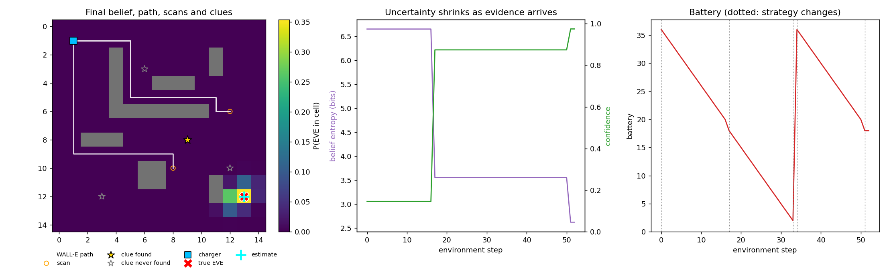

# WALL-E and EVE's Signal

An autonomous agent that explores a simulated environment, gathers noisy clues, manages a limited
battery and time budget, and works out **where EVE is** (and what state she is in).

* Pure Python + NumPy. No game engine, no ML libraries.
* The world is loaded from a **JSON/YAML mission config**; clue locations are hidden and can only
  be learned by interacting with the environment.
* The agent keeps a **Bayesian belief** (a probability grid) over EVE's location, updates it from every
  observation, and picks its next move by **expected information gain vs. travel cost**.
* Every step is logged (action, observation, decision, reasoning), and each mission ends with a
  **report** (evidence, inferred location/status, confidence, recommended next step).

```
python run.py configs/sample1.json --out outputs/sample1
```



*Sample 1: final belief (bright = likely), WALL-E's path, scan points, clues, the true EVE and the
estimate; belief entropy and confidence over time; battery with the two recharge trips.*

---

## Contents

1. [Quick start](#quick-start)
2. [How it works](#how-it-works)
3. [Environment design](#environment-design)
4. [Config format](#config-format)
5. [The agent](#the-agent)
6. [Outputs](#outputs)
7. [Sample missions and results](#sample-missions-and-results)
8. [Generalisation benchmark](#generalisation-benchmark)
9. [Tests](#tests)
10. [Design decisions and limitations](#design-decisions-and-limitations)
11. [Project layout](#project-layout)

---

## Quick start

```bash
git clone <github.com/Neilfal/walle-eve-signal/> && cd walle-eve-signal
python -m venv .venv && source .venv/bin/activate      # optional
pip install -r requirements.txt                         # numpy
pip install -r requirements-optional.txt                # optional: matplotlib (PNG), pyyaml (YAML configs)

python run.py configs/sample1.json --out outputs/sample1            # run a mission
python run.py configs/sample1.json -v                               # ...and print the full trace
python run.py configs/sample3_maze.yaml --out outputs/sample3_maze  # YAML config
python benchmark.py --n 20                                          # many random missions
python -m unittest discover -s tests -v                             # tests
```

`run.py` options: `--out DIR` (write files), `--seed N` (override the environment seed),
`--agent-seed N`, `--no-plot`, `-v/--verbose`.

Use it as a library:

```python
from walle_eve import run_mission
result = run_mission("configs/sample1.json", out_dir="outputs/sample1")
print(result["report"]["inferred_location"], result["report"]["confidence"])
```

---

## How it works

```
 mission config (JSON/YAML)
          │
          ▼
 ┌───────────────────┐   briefing: map, costs, sensor calibration,     ┌──────────────────────────┐
 │  MissionEnv       │ ──────────── initial signal ──────────────────▶ │  Agent (WALL-E)           │
 │  (hidden: EVE,    │                                                  │  • Belief (prob. grid)    │
 │   clues, noise)   │ ◀──────── action: move / scan / recharge / stop ─│  • planner (info gain     │
 │                   │ ─────────── observation ───────────────────────▶ │    vs. cost, reserve)     │
 └───────────────────┘                                                  └──────────────────────────┘
          │                                                                         │
          └────────────── Trace (every step)  +  Report (final) ◀──────────────────┘
```

The environment and the agent are strictly separate: the agent is built from `env.briefing()` only
(there is a test that the briefing contains no hidden state) and afterwards sees nothing but the
observations that `env.step()` returns.

---

## Environment design

**Map.** A grid of free cells and walls. Movement is 4-connected (N/S/E/W). The map layout is part of
the briefing; what is hidden is *where EVE is* and *where the clues are*. Coordinates are `(x, y)`
with `x` = column and `y` = row from the top; North is up. Bearings are compass degrees clockwise
from North (0 = N, 90 = E).

**Actions** (each costs battery and time, set in the config):

| action | effect | default cost (battery / time) |
|---|---|---|
| `{"type":"move","dir":"N"}` | walk one cell (walls/edges block; blocked moves cost nothing and count as invalid) | 1 / 1 |
| `{"type":"scan"}` | noisy signal reading + reveals clues nearby + checks for a direct sighting | 2 / 1 |
| `{"type":"recharge"}` | refill battery; only on a charger cell; limited by `max_recharges` | 0 / 6 |
| `{"type":"stop"}` | end the mission and file the report | free |

**What a scan returns**

| field | meaning |
|---|---|
| `strength` | signal strength, `s0 · exp(−d / decay_length)` plus Gaussian noise (`d` = distance to EVE) |
| `bearing_deg` | compass bearing towards EVE, with noise `base + per_cell · d` degrees (farther = noisier) |
| `eve_in_view` / `eve_position` / `eve_status` | direct sighting if EVE is within `visual_range` (1.5 cells) |
| `clues` | every clue within `clue_scan_radius` (2 cells), including its evidence |

**Clue types**

| type | evidence | extra fields |
|---|---|---|
| `bearing` | compass bearing from the clue to EVE (noisy, stated `sigma`) | `decoy`, `decoy_target` |
| `range` | distance from the clue to EVE (noisy, stated `sigma`) | `decoy`, `decoy_offset` |
| `status` | a hint about EVE's state (`low_power`, `damaged`, `dormant`, `active`, ...) | `hint` |

**Decoys and spoofing (advanced).** A clue with `"decoy": true` gives *misleading* evidence (a bearing
towards a fake target, or a distance that is off by `decoy_offset`). With `sensor.spoof_prob > 0`, a
scan occasionally returns a completely random reading. Neither is ever flagged to the agent.

**Termination.** The mission ends when the agent stops, time runs out, the battery is empty away from a
usable charger, or the agent sends too many invalid actions.

**Reproducibility.** All randomness comes from `seed` in the config (override with `--seed`). Clue
evidence is generated at reset, so it does not depend on the order in which the agent finds clues.

---

## Config format

JSON or YAML. Only `grid`, `start`, `chargers`, `eve`, `initial_signal` and `budget` are required;
everything else has the defaults shown.

```jsonc
{
  "name": "Sample 1 - the quiet corridor",
  "seed": 7,                                    // environment randomness (default 0)

  "grid": { "rows": ["....#...", "...##..."] },  // ASCII map: '#' wall, '.' free
  // ...or:  "grid": { "width": 15, "height": 15, "walls": [[4,2],[4,3]] }

  "start": [1, 1],
  "chargers": [[1, 1]],                         // at least one; where recharge works
  "eve": { "position": [13, 12], "status": "low_power" },     // HIDDEN from the agent

  "initial_signal": {                           // given to the agent at the start
    "bearing_deg": 94, "strength": 0.16, "timestamp": 0, "bearing_sigma_deg": 30
  },

  "budget": {
    "battery": 36, "time": 150, "max_recharges": 3,
    "costs": { "move": {"battery":1,"time":1}, "scan": {"battery":2,"time":1},
               "recharge": {"battery":0,"time":6} }
  },

  "sensor": {                                   // calibration is known to the agent, except spoof_prob
    "s0": 1.0, "decay_length": 8.0, "strength_sigma": 0.04,
    "bearing_sigma_base_deg": 8, "bearing_sigma_per_cell_deg": 1.5,
    "clue_scan_radius": 2, "visual_range": 1.5,
    "spoof_prob": 0.0                           // HIDDEN: chance a scan is garbage
  },

  "clues": [                                    // HIDDEN until scanned nearby
    { "id": "c1", "type": "bearing", "position": [6, 3], "sigma": 15 },
    { "id": "c2", "type": "range",   "position": [9, 8], "sigma": 1.5 },
    { "id": "c3", "type": "status",  "position": [12, 10], "hint": "low_power" },
    { "id": "c4", "type": "bearing", "position": [3, 12], "sigma": 15,
      "decoy": true, "decoy_target": [2, 2] }
  ]
}
```

The loader validates everything (positions inside the map and not in walls, unique clue ids, EVE /
chargers / clues all reachable from the start, sensible numbers) and raises a clear `ConfigError`.

`python -c "from walle_eve.generator import random_config; ..."` builds random valid configs
(`benchmark.py` uses it).

---

## The agent

### 1. Belief: where is EVE?

The agent keeps `P(EVE is in cell c)` for every free cell, starting uniform. Each observation becomes a
likelihood map and the posterior is `prior × likelihood`, renormalised (Bayes' rule):

| evidence | likelihood used for cell `c` |
|---|---|
| signal strength `s` read at `p` | Gaussian around `s0·exp(−dist(p,c)/L)` |
| bearing `θ` read at `p` | Gaussian on the angle difference to `bearing(p→c)`, σ grows with `dist(p,c)` |
| bearing clue at `q` | same, with the clue's stated σ |
| range clue at `q` | Gaussian around `dist(q,c)` |
| scan with EVE **not** in view | cells within visual range are almost ruled out (×0.01) |
| scan with EVE in view | belief collapses onto EVE's cell |

Every likelihood is mixed with a small uniform "outlier" term (5 % for scan readings, 20 % for clues).
This is what makes spoofed signals and decoy clues survivable: a single bad reading dents the belief
but cannot destroy it, and later good evidence wins.

*Estimate and confidence.* The estimate is the centre of the 3×3 block holding the most probability;
**confidence = P(EVE lies in that 3×3 block)**.

### 2. Decisions: what to do next

Each time the plan is empty, `Agent.act()` runs this logic:

1. **Stop?** Yes if EVE has been seen, or confidence ≥ 0.90 after at least 2 scans.
2. **Battery management.**
   * At a charger and below 70 % charge → `recharge` ("topping up before the next excursion").
   * Away from base and at or below 30 % charge → **turn back** to the nearest charger (BFS shortest path).
3. **Choose a scan point.** For every reachable cell the agent computes
   `utility = expected information gain (bits) + new-area bonus − 0.03 × battery cost`.
   * *Expected information gain* is a Monte-Carlo estimate: sample hypotheses for EVE's position from
     the belief, simulate the scan WALL-E would get under each (noisy strength + bearing, or a direct
     sighting), compute the posterior entropy and average. The expected entropy reduction is the gain.
     This single number automatically balances triangulating from far-apart points, approaching the
     belief peak to *verify* it, and avoiding scans that would say nothing new.
   * *Safety constraint:* a cell is a candidate only if, after travelling there and scanning, the battery
     still covers the trip to the **nearest charger** plus a small margin. WALL-E is never stranded.
   * If nothing is affordable the agent turns back, recharges if it can, and otherwise stops.
4. Walk the BFS path, scan on arrival, update the belief and **re-plan with the new evidence**.

Each action in the trace carries the reasoning behind it, including the runner-up option and the
battery arithmetic. A **strategy timeline** records each change of mode (`explore`, `verify`, `return`,
`recharge`, `finish`) and why.

### 3. Final report

`report.md` / `report.json` contain: outcome (`EVE_LOCATED`, `EVE_LOCALIZED`, `EVE_PROBABLY_LOCATED`,
`INCONCLUSIVE`), inferred location, confidence, 90 % credible region size, inferred status, the evidence
table (each clue checked for consistency with the final belief), top hypotheses, strategy timeline, resource
use, a **recommended next step** (with path length and whether the current charge is enough), and, since the
evaluator knows the truth, an evaluation section (error in cells, whether decoys were found).

---

## Outputs

`python run.py CONFIG --out DIR` writes:

| file | content |
|---|---|
| `trace.jsonl` | one JSON object per step: action, reasoning, plan, full observation, belief summary |
| `trace.txt` | the same, human-readable |
| `report.md`, `report.json` | the final mission report |
| `map_frames.txt` | ASCII map after the initial signal and after every scan (belief digits, path `*`, clues `c`, chargers `B`, `W` WALL-E, `X` estimate) |
| `map_final.txt` | the last frame with the true EVE (`E`) revealed |
| `mission.png` | belief heat-map with path, scans and clues; entropy/confidence and battery over time (needs matplotlib) |

A step in `trace.txt`:

```
[step 017 | t=017 | battery 20 -> 18 | mode explore] SCAN from (12, 6)
   why : Arrived at (12, 6): taking a reading.
   saw : Scanned at (12, 6): strength 0.449, bearing 154 deg. ...
   belief: estimate (13, 12), confidence 87%, entropy 3.56 bits
```

---

## Sample missions and results

| config | what it shows | result |
|---|---|---|
| `configs/sample1.json` | 15×15 map, single charger, tight battery (36), noisy initial bearing | localised EVE with 97 % confidence after 2 scans, one **turn-back and recharge** |
| `configs/sample2_decoys.json` | 20×20, two chargers, 2 **decoy clues**, 10 % **spoofed scans**, 1.5× sensor noise | located and visually confirmed EVE despite a decoy clue and a spoofed scan |
| `configs/sample3_maze.yaml` | 10×10 maze, **YAML** config, battery 30 | localised EVE with 99 % confidence, 1 recharge |

Full traces, reports, maps and plots are committed in `outputs/`. Results depend on the seeds in the
configs; re-running reproduces them exactly.

---

## Generalisation benchmark

`python benchmark.py --n 50 --seed 1000` runs the same agent, with no per-mission tuning, on randomly
generated missions (random walls, EVE and clue positions, statuses):

| profile | missions | EVE located within 1.5 cells | visually confirmed | median error | mean scans | mean recharges | stranded | wrong but ≥90 % confident |
|---|---|---|---|---|---|---|---|---|
| standard (15×15, 4 clues, normal noise) | 50 | 100 % | 60 % | 0.00 | 2.0 | 0.3 | 0 | 0 |
| hard (20×20, 2 decoys, 10 % spoofed scans, 1.5× noise, 2 chargers) | 50 | 98 % | 48 % | 0.00 | 2.5 | 0.4 | 0 | 1 |

"Located" counts missions whose final estimate is within the visual range (1.5 cells) of the true
position; the rest of the missions end with a high-confidence estimate that the recommended next step
would verify. The one hard-profile failure is an instructive one: spoofed readings plus a decoy produced
a confident but wrong belief, and the agent stopped before verifying it. Raising `conf_stop`, or
requiring a visual confirmation, trades budget for robustness. Per-mission rows are in
`outputs/benchmark/benchmark.csv`.

---

## Tests

`python -m unittest discover -s tests -v` (25 tests, ~3 s) covers config validation, environment rules
(costs, walls, recharge, clue radius, sightings, budget exhaustion, determinism, the briefing hiding
secrets), belief maths (normalisation, walls, convergence on noiseless evidence, outlier floors) and agent
behaviour (never stranded or invalid on random missions, recharges when it has to, deterministic runs,
outputs written, clue-consistency check). GitHub Actions runs them on Python 3.10-3.12 plus a smoke test
of each sample mission.

---

## Design decisions and limitations

* **Why a probability grid?** Small maps make exact Bayesian filtering cheap, and the belief is easy to
  inspect, plot and explain.
* **Why information gain?** One utility replaces many hand-tuned rules: it favours scanning far from
  earlier scans (triangulation), approaching a confident peak to verify it, and skipping useless scans.
  The Monte-Carlo estimate uses common random numbers so candidate cells are compared fairly.
* **Hard safety constraint, soft everything else.** Getting home is a constraint on candidate scan
  points rather than a reward, so no choice of weights can strand WALL-E.
* **Limits.** Walls do not block signals or sight; the map is fully known; EVE does not move; the agent
  scans only at chosen points (it learns nothing while walking); one agent only. The tuning constants
  (`DEFAULT_PARAMS` in `walle_eve/agent.py`) were chosen by hand, not optimised.
* **Ideas to extend:** moving or evasive EVE, line-of-sight blocking, partially known maps, several
  cooperating agents, an LLM planner compared against this classical one on the same benchmark, an
  animated visualisation, a Gazebo/Webots front end.

---

## Project layout

```
walle-eve-signal/
├── README.md
├── run.py                  # run one mission
├── benchmark.py            # random-mission generalisation benchmark
├── requirements.txt        # numpy
├── requirements-optional.txt
├── configs/                # sample1.json, sample2_decoys.json, sample3_maze.yaml
├── walle_eve/
│   ├── config.py           # load / validate / defaults
│   ├── env.py              # the simulated world (hidden state, observations, budget)
│   ├── belief.py           # Bayesian belief grid and sensor likelihoods
│   ├── agent.py            # planner, battery management, evidence handling
│   ├── trace.py            # step-by-step trace (jsonl + text)
│   ├── report.py           # final mission report
│   ├── viz.py              # ASCII frames + matplotlib summary
│   ├── generator.py        # random valid missions
│   ├── geometry.py         # bearings, BFS, helpers
│   └── mission.py          # glue: env + agent + trace + report + files
├── tests/
├── outputs/                # committed sample traces, reports, maps, plots, benchmark
└── .github/workflows/ci.yml
```

## License

MIT, see `LICENSE` (replace `<YOUR NAME>`).
